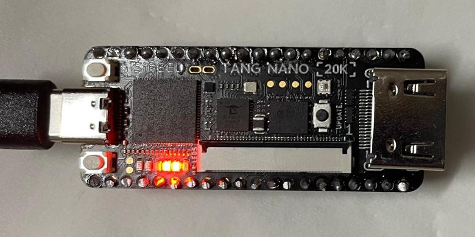
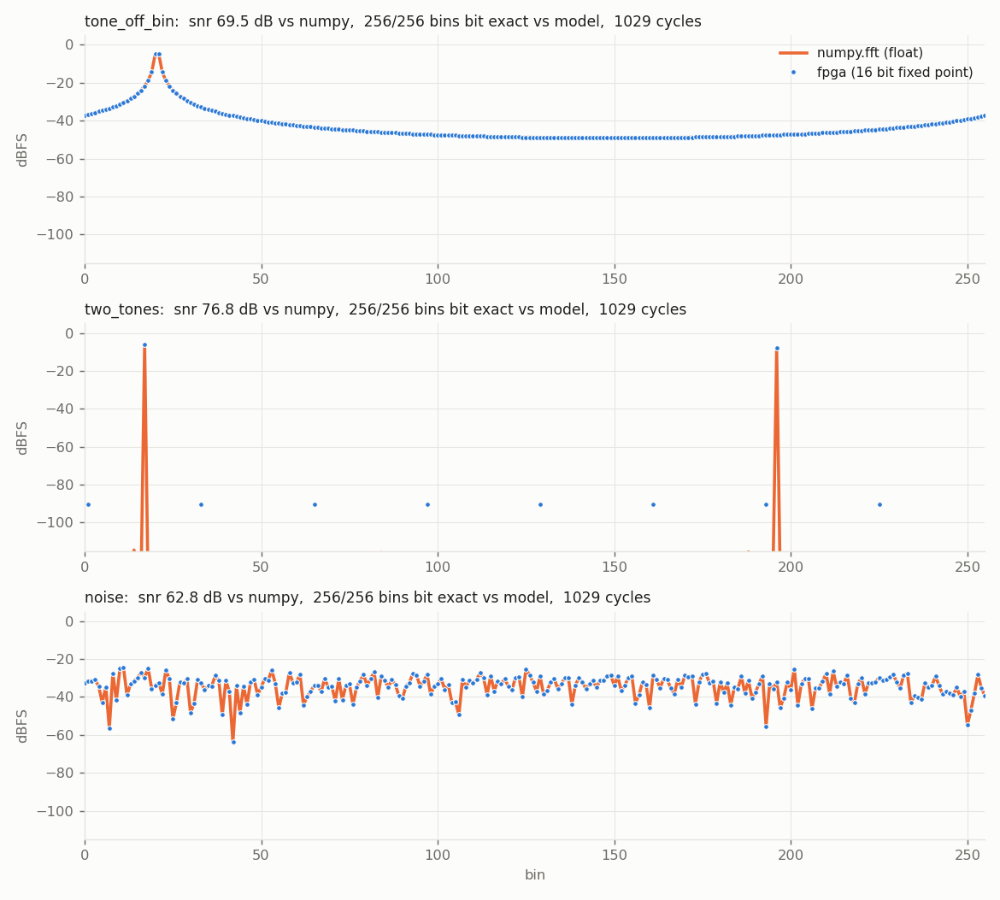
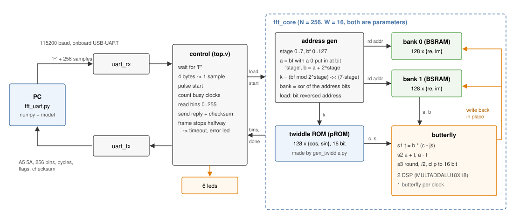
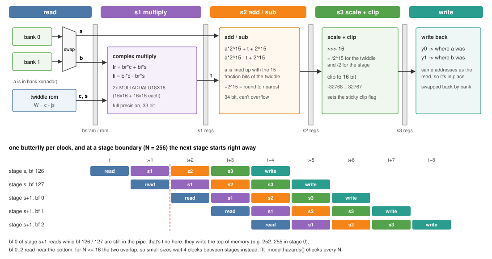
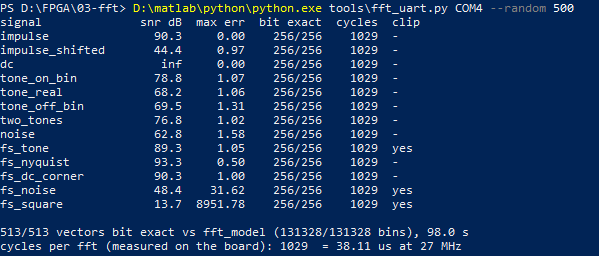

# 256-point FFT on the Tang Nano 20K

[](https://github.com/Amr-Khaled-Amein/fft-accelerator-fpga/actions/workflows/sim.yml)

A radix-2 Cooley-Tukey FFT in Verilog, running on a Tang Nano 20K (Gowin GW2AR-18).
One pipelined butterfly unit does all 8 stages in place, one butterfly per clock,
16 bit fixed point I/Q. The PC sends 256 complex samples over the onboard USB UART,
the FPGA does the FFT and sends back the 256 bins and how many clocks it took.



*The board after a run. LED 3 toggles after every FFT, LED 4 means the last one clipped
(`fs_square` does that on purpose).*



*Captured on the board: FPGA output (dots) on top of `numpy.fft` (line). The flat floor
at about -90 dB in `two_tones` is 1 LSB of the 16 bit output.*

- 1029 clocks per 256-point FFT = 38.1 us at 27 MHz (measured by a counter on the board)
- Fmax 104.8 MHz, 1027 logic cells / 449 FFs (5% / 3% of the GW2AR-18), 3 BSRAM, 2 DSP
- output is bit exact against a Python model of the same fixed point algorithm:
  513 / 513 vectors on the board, 410 in every simulation run
- SNR against `numpy.fft`: 68-79 dB on tones, 63 dB on noise, 44-93 dB over all signals that don't clip (table below)
- N and the data width are parameters, tested from N = 4 to 2048 and 10 to 24 bit

## how it works



The samples are written to memory at the bit reversed address while they come in.
Then the core runs log2(N) = 8 stages of N/2 = 128 butterflies. In stage `s`
butterfly `bf` works on

```
a = bf with a 0 put in at bit s        b = a + 2^s        twiddle k = (bf mod 2^s) << (7 - s)
```

and writes the two results back to the same two addresses (in place). After the
last stage the bins are in natural order.

A butterfly needs 2 reads and 2 writes every clock, but a BSRAM block only has one
read and one write port. So the memory is split into two banks by the parity (xor) of
the address bits. `a` and `b` differ in exactly one bit, so they always have
different parity and are always in different banks. Each bank then only sees one
read and one write per clock. `a` can be in either bank, so a swap mux sorts them
out on the read side and swaps them back on the write side.

The twiddle ROM holds cos and sin for k = 0..127. `tools/gen_twiddle.py` writes it as a
plain Verilog case statement for any power of 2 N and any width, rounded to nearest and
saturated (cos 0 = 1.0 doesn't fit in Q1.15, it becomes 0x7fff). Gowin puts it in a
BSRAM as a pROM.

## butterfly pipeline



```
t  = b * (c - js)                         s1: 2 multiply-adds, full precision
y0 = clip((a * 2^15 + t + 2^15) >> 16)    s2: add / sub with the rounding constant
y1 = clip((a * 2^15 - t + 2^15) >> 16)    s3: shift, clip to 16 bit
```

Shifting by 16 instead of 15 scales every stage by 1/2, so the output is `fft(x) / 256`.
With `|x| <= 1`, `|y0|, |y1| <= (|a| + |b|) / 2 <= 1`, so nothing grows past full scale.
The only thing left is rounding right at +1.0, which clips by 1 LSB (`fs_tone` below).
Inputs out in the corners (re and im both near full scale, so |x| up to 1.41) can really
go over, and those clip instead of wrapping around. A sticky flag says when that happened and the board
sends it back with the result.

The 4 products map to 2 `MULTADDALU18X18` DSP blocks, each doing `p*q + r*s` in one go.

A result is written 4 clocks after its butterfly was read. Normally the next stage
would have to wait for that. But with this butterfly order, the first butterflies of a
stage only touch the bottom of memory, while the last ones of the stage before are
still writing the top. So for N >= 32 the stages just run back to back:
1029 = 8 x 128 + 5 clocks, and 99.5% of the clocks do a butterfly. Below 32 the two
overlap and the core waits 4 clocks between stages. `fft_model.hazards()` checks
this for every N, and `run_tests.py` runs it.

## results

Every signal below was run on the board. All of them came back bit exact against the
model, with the same clip flag and the same cycle count as the simulation.



*`fft_uart.py COM4 --random 500`: the 13 test signals and 500 random vectors, 98 s for all 513.*

| signal | what it is | SNR vs numpy | max error | clipped |
|---|---|---|---|---|
| `impulse` | x[0] = full scale | 90.3 dB | 0.00 LSB | |
| `impulse_shifted` | one complex sample in the middle | 44.4 dB | 0.97 LSB | |
| `dc` | 0.9 everywhere | exact | 0 | |
| `tone_on_bin` | complex tone, bin 10 | 78.8 dB | 1.07 LSB | |
| `tone_real` | real cosine, bin 37 | 68.2 dB | 1.06 LSB | |
| `tone_off_bin` | complex tone, bin 20.5 (leaks everywhere) | 69.5 dB | 1.31 LSB | |
| `two_tones` | bins 17 and -60 | 76.8 dB | 1.02 LSB | |
| `noise` | uniform, half scale | 62.8 dB | 1.58 LSB | |
| `fs_tone` | complex tone at full scale | 89.3 dB | 1.05 LSB | 1 LSB |
| `fs_nyquist` | +1, -1, +1, ... | 93.3 dB | 0.50 LSB | |
| `fs_dc_corner` | -1 - 1j everywhere | 90.3 dB | 1.00 LSB | |
| `fs_noise` | random corners, +-1 +-1j | 48.4 dB | 31.6 LSB | yes |
| `fs_square` | complex square wave on the corners | 13.7 dB | 8952 LSB | yes |
| random | 500 random vectors (noise, tones, impulses, corners) | | | 513/513 bit exact |

SNR is `sum |numpy|^2 / sum |fpga - numpy|^2` over all 256 bins, with numpy given the
same 16 bit input. Errors are in output LSBs. Because of the 1/2 per stage, a signal
spread over all bins (noise, a single impulse) ends up small at the output and gets a
lower SNR than a tone that lands in one bin. The last two are there to hit the clip
logic: their true FFT goes past full scale, so the big error is expected. The point is
that the board clips exactly like the model does.

| | |
|---|---|
| clocks per FFT | 1029 (board counter = simulation) |
| time per FFT at 27 MHz | 38.1 us |
| Fmax (Gowin timing report) | 104.8 MHz, +27.5 ns slack at 27 MHz |
| whole design | 1027 logic (847 LUT + 156 ALU + 4 SSRAM), 449 FF, 3 BSRAM, 2 DSP |
| fft_core alone (synthesis) | 476 LUT + 142 ALU, 193 FF, 3 BSRAM (2 SDPB banks + pROM), 2 DSP |
| one FFT over UART | ~0.19 s round trip, almost all of it is 115200 baud |

## verification

`tools/run_tests.py` does all of this (about 2 minutes):

1. twiddle generator: every entry for N = 4..4096 and 8..24 bit is within 1/2 LSB of
   the real value, or saturated
2. the pipeline schedule has no stale reads for any N
3. the bit accurate model (`fft_model.py`) against numpy, so that matching it means something
4. RTL at N = 256, 16 bit: the 13 directed signals + 100 random vectors, every bin and
   the clip flag compared by the self checking testbench `sim/tb_fft.sv`
5. RTL at 9 other sizes and widths (N = 4 .. 2048, data 10 .. 24 bit, twiddle 10 .. 20 bit),
   each with its own generated ROM, 33 vectors each
6. the whole design over UART (`sim/tb_top.sv`): junk bytes, a frame that stops halfway
   and has to time out, then full frames checked byte by byte
7. mutants: the RTL is broken on purpose in 14 different ways, and every one has to make
   a test fail:

| mutant | | mutant | |
|---|---|---|---|
| truncate instead of round | caught | a and b swapped on read | caught |
| wrong sign in the twiddle multiply | caught | write mux uses the wrong pipeline stage | caught |
| no 1/2 scale on one output | caught | bank address delayed one stage too few | caught |
| no saturation, wraps around | caught | drain between stages too short | caught |
| clip flag never set | caught | stages overlap for small N too | caught |
| no bit reversal on load | caught | one stage missing | caught |
| twiddle index off by one | caught | one twiddle entry 1 LSB off | caught |

On the board, `fft_uart.py` sends the same 13 signals plus random ones, and checks
every bin against the model and against numpy.

## running it

Needs Icarus Verilog 12, Python 3 with numpy (+ pyserial and matplotlib for the board) and
Gowin EDA (the free Education version is enough).

```
cd tools
python run_tests.py                       # everything, ~2 min
python run_tests.py --random 500 --no-mutants
python gen_twiddle.py --n 1024 --width 18 -o rom.v    # a ROM for some other size
```

Build and program:

```
cd fft
gw_sh build.tcl                           # or open fft.gprj in the IDE and Run All
programmer_cli --device GW2AR-18C --run 2 --fsFile impl/pnr/fft.fs
```

Talk to it (pick your own COM port, `--list` shows them):

```
python tools/fft_uart.py COM4                          # 13 test signals
python tools/fft_uart.py COM4 --random 500             # + 500 random vectors
python tools/fft_uart.py COM4 --signal two_tones --show
python tools/fft_uart.py COM4 --plot spectrum.png --save capture.json
```

## uart protocol

115200 8N1. Values are 16 bit signed, big endian.

| direction | bytes |
|---|---|
| PC -> FPGA | `'F'`, then 256 x (re, im) = 1025 bytes |
| FPGA -> PC | `A5 5A`, 256 x (re, im) bins, clocks (4 bytes), flags (bit 0 = clipped), xor of everything after `A5 5A` = 1032 bytes |

If a frame stops halfway for more than 100 ms, the board drops it and turns on the error LED.

LEDs: 0 receiving, 1 FFT running (stretched so you can see it), 2 sending, 3 toggles
after every FFT, 4 last FFT clipped, 5 error.

## layout

```
fft/src/      rtl: fft_core.v, sample_ram.v (one bank), twiddle_rom.v (generated),
              top.v, uart_tx/rx, pin + clock constraints
sim/          tb_fft.sv (core, self checking), tb_top.sv (whole design over uart)
tools/        gen_twiddle.py, fft_model.py, gen_vectors.py, run_tests.py, fft_uart.py
docs/         diagrams, spectrum plot, board_capture.json (the 13 signals from the board)
```

## notes

- `run_tests.py` rewrites `fft/src/twiddle_rom.v` for N = 256 / 16 bit at the end.
  For another size, generate the ROM and set `N` in `top.v`. The UART frame is fixed at
  16 bit, so `W` only changes in `fft_core`.
- Gowin gives a PR1014 warning about the clock. Pin 4 on this board isn't a dedicated
  clock pin, so the clock goes over normal routing. Timing still has lots of margin.
- Gowin packs some of the pipeline delay registers into 4 small shift register RAMs
  (SSRAM). Only registers without a reset can go there. The pipeline doesn't need them
  to reset, since the valid bits next to them do.
